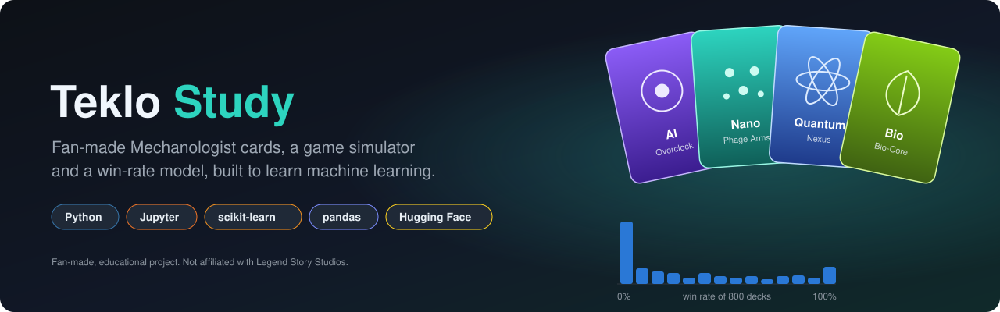
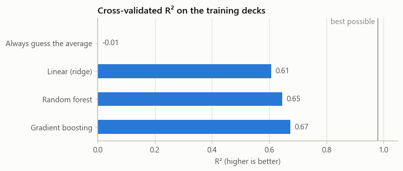
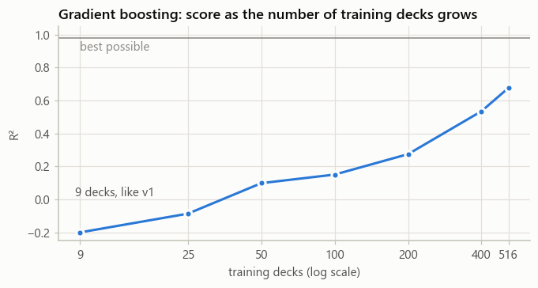
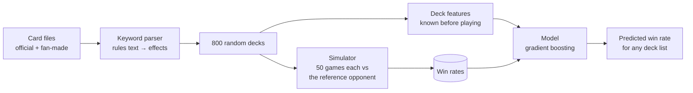

<p align="center">
  
</p>

<p align="center">
  <a href="https://www.python.org"></a>
  <a href="https://jupyter.org"></a>
  <a href="https://scikit-learn.org"></a>
  <a href="https://pandas.pydata.org"></a>
  <a href="https://huggingface.co/4math/FAB_Prediction_Model"></a>
  
</p>

<p align="center">
  <b>Dream cards for Teklovossen, the Mechanologist hero of Flesh and Blood</b><br>
  fan-made designs, a small game simulator to try them out, and a win-rate model written as a step-by-step way to learn machine learning in Jupyter.
</p>

<p align="center">
  <a href="#-quick-start">Quick start</a> ·
  <a href="#-learning-notebooks">Notebooks</a> ·
  <a href="docs/cards.md">Cards</a> ·
  <a href="docs/simulator.md">Simulator</a> ·
  <a href="docs/features.md">Features</a> ·
  <a href="examples/README.md">Examples</a> ·
  <a href="docs/v1.md">v1</a>
</p>

> **Fan-made project.** Not affiliated with Legend Story Studios or the official Flesh and Blood game.

---

## ✨ Features

- 🃏 **38 dream cards for Teklovossen** along four tech paths (AI, Nano, Quantum, Bio), with design notes in [`teklostudy.md`](teklostudy.md) and AI-generated concept art in [`evos/`](evos).
- ⚔️ **A readable game simulator**: a small Flesh and Blood-style duel where cost, pitch, power, defense, Go again, Boost, items and Evos all matter, about 0.7 ms per game.
- 🎲 **800 random decks × 50 games**, played against one fixed opponent: real variety for a model to learn from.
- 📓 **Learning notebooks** that build the prediction step by step: sanity checks, feature engineering, the leakage trap, baselines, cross-validation, learning curves and a held-out test set.
- 📈 **An honest model**: cross-validated R² 0.67 and 0.68 on unseen decks, where v1 scored −1.33.
- 🧪 **Examples** that predict any deck list's win rate and print a game turn by turn.
- ✅ **Tests** for the simulator: fair mirror matches, reproducible games, decks without attacks lose.

## 🃏 The cards

| Path | Focus | Key cards |
|---|---|---|
| 🟣 **AI** | AI items and combat protocols | `AI - Overclock Core`, `AI - Predator Logic`, `AI - Singularity Cannon` |
| 🟢 **Nano** | self-replicating nanites, adaptive armor | `Evo - Nanite Core Reactor`, `Evo - Phage Arms`, `Nanite Devastator` |
| 🔵 **Quantum** | probability control | `Evo - Quantum Processor`, `Evo - Quantum Nexus` |
| 🌿 **Bio** | bio-mechanical symbiosis | `Evo Bio-Oaken Soul` set, `Evo Bio-Core Reactor`, `Symbiotic Strike` |

<p align="center">
  
  
  
  
  <br><sub>Concept art: Teklo Custom Fabrication, Quantum Nexus, Quantum Processor and a Biomancy Evo.</sub>
</p>

<p align="center">
  
  
  <br><sub>Teklo Memory and Teklo Energy, the resource tokens of the fan-made expansion.</sub>
</p>

More on the cards, how they are read and how to add one: **[docs/cards.md](docs/cards.md)**.

## 📈 Results

The question: **given only a deck list, how often will this deck win against the reference opponent?**

| | v1 | v2 |
|---|---|---|
| Training rows | 9 deck presets (5 of them identical) | 800 random decks |
| Cross-validated R² | −1.33 (worse than guessing the average) | **0.67** |
| Held-out test R² | not measured | **0.68**, average miss 15 points |
| Best R² possible (luck of 50 games) | | 0.98 |

<p align="center">
  
  
  <br><sub>Left: four models compared with cross-validation. Right: with 9 decks, as in v1, the model is worse than guessing.</sub>
</p>

What went wrong in v1 and how v2 fixes it: **[docs/v1.md](docs/v1.md)**.

## 🚀 Quick start

**Requirements**: Python 3.11 and git.

```bash
git clone https://github.com/4math2379/Evo-Study-FAB-ccg.git
cd Evo-Study-FAB-ccg
python -m venv venv
venv\Scripts\activate             # Windows. On macOS or Linux: source venv/bin/activate
pip install -r requirements-v2.txt
python -m pytest                  # 6 checks of the simulator
jupyter lab notebooks/v2
```

Run the notebooks in order: each one saves what the next needs in `data/v2/` and `models/v2/` (about two minutes in total). Then try a deck:

```bash
python examples/predict_deck.py examples/decks/nano_evo.txt --simulate 200
```

```text
Predicted win rate against the reference opponent: 84%
Simulated over 200 games: 93% (difference +9%)
```

## 📓 Learning notebooks

| # | Notebook | What you learn |
|---|---|---|
| 01 | [Simulate games](notebooks/v2/01_simulate.ipynb) | build data you can trust: the simulator, a game play by play, sanity checks, 800 random decks |
| 02 | [Build the dataset](notebooks/v2/02_dataset.ipynb) | features from the deck list only, feature engineering (0.39 → 0.66), the leakage trap (a fake 0.97) |
| 03 | [Train and evaluate](notebooks/v2/03_train_evaluate.ipynb) | baselines, cross-validation, the best score possible, learning curves, the test set, what the model relies on, the value of each card |
| 04 | LLMs with Hugging Face Inference Providers | *coming next*: an LLM reads the fan-made card texts the keyword parser can't |
| 05 | Publish to the Hugging Face Hub | *coming next*: the dataset and a fixed model with a working Quick Start |

## 🧭 How it works



1. [`teklo.load_cards`](teklo/cards.py) reads both card files and a small parser turns rules text into effects ([Cards](docs/cards.md)).
2. [`teklo.random_deck`](teklo/decks.py) builds deck-like random decks: 10 to 15 different cards, 1 to 3 copies each, 30 cards.
3. [`teklo.evaluate_deck`](teklo/engine.py) plays each deck against the reference opponent, alternating who goes first ([Simulator](docs/simulator.md)).
4. [`teklo.deck_features`](teklo/features.py) describes each deck with 32 numbers known before any game is played ([Features](docs/features.md)).
5. A scikit-learn model learns win rate from those features ([Data and model files](docs/data-format.md)).

## 🧪 Examples

| Script | What it does |
|---|---|
| [`examples/predict_deck.py`](examples/predict_deck.py) | predicts a deck list's win rate, and checks it by simulation with `--simulate N` |
| [`examples/play_one_game.py`](examples/play_one_game.py) | prints one game against the reference opponent, turn by turn |

Deck list format and the two example decks: **[examples/README.md](examples/README.md)**.

## 🧱 Tech stack

| | Technology | Role in this project |
|---|---|---|
|  | [Python](https://www.python.org) 3.11 | the `teklo` package, examples and tests |
|  | [Jupyter](https://jupyter.org) | the learning notebooks |
|  | [scikit-learn](https://scikit-learn.org) | models, cross-validation, learning curves, permutation importance |
|  | [pandas](https://pandas.pydata.org) | card files, datasets, results tables |
| 📊 | [matplotlib](https://matplotlib.org) | charts, with a colorblind-checked palette (`teklo/plotting.py`) |
|  | [Hugging Face](https://huggingface.co) | the published model; Inference Providers and the Hub in notebooks 04 and 05 |
|  | [pytest](https://pytest.org) | simulator checks |

## 🗂️ Repository layout

```
teklo/              v2 package: cards, engine, decks, features, plotting
notebooks/v2/       learning notebooks 01 to 03
examples/           predict_deck.py, play_one_game.py, example deck lists
tests/              simulator checks (pytest)
docs/               documentation, banner and chart images
custom_cards.csv    the fan-made cards (tab-separated)
notebooks/card.csv  the official card database (tab-separated)
teklostudy.md       full card texts and design notes
evos/               concept art
data/v2/, models/v2/  generated by the notebooks (gitignored)

simulation/, teklostudyv1.ipynb, notebooks/gameplay_simulator.ipynb, quick_demo.py
                    v1 code, unchanged (see docs/v1.md)
```

## 🛠️ Commands

| Command | What it does |
|---|---|
| `pip install -r requirements-v2.txt` | install what v2 needs |
| `python -m pytest` | run the simulator checks |
| `jupyter lab notebooks/v2` | open the learning notebooks |
| `python examples/predict_deck.py <deck.txt> [--simulate N]` | predict a deck's win rate |
| `python examples/play_one_game.py <deck.txt> [--seed N]` | print one game turn by turn |

## 💡 Why this project

As a new Flesh and Blood player looking for a hero that fits my playstyle, I picked Teklovossen: I'm a programmer and I love science fiction, so a hero who bends technology to his will was a perfect match. Back then his card pool was small, and he struggled to compete.

A friend of mine, known as "If I have a Blue I Win", told me one day: **"Why not create additional cards for Teklovossen, and see if he can be more competitive?"** So I did. Thank you, **Laurent**!

Since then, the official card pool has grown and Teklovossen is competitive on his own. So the project changed purpose: these are now **dream cards**, the AI, Nano, Quantum and Bio designs I'd love to see one day, with a simulator to try them out. They are not fixes for a weak hero.

The prediction side started as a way to understand how machine learning works, and v2 rebuilt it as a series you can learn from.

## 🤝 Contributing

Dream card ideas, balance suggestions and pull requests are welcome. For a new card, add it to `custom_cards.csv` and `teklostudy.md`, check how the simulator reads it, and re-run the notebooks ([how](docs/cards.md#adding-or-changing-a-card)).

Questions, ideas or problems: please **[open an issue](https://github.com/4math2379/Evo-Study-FAB-ccg/issues)**. That's the way to get in touch.

## 📄 License

Personal project, educational use. Flesh and Blood and Teklovossen belong to Legend Story Studios; this project is fan-made and not affiliated with them. The official card data in `notebooks/card.csv` is used for study only.
