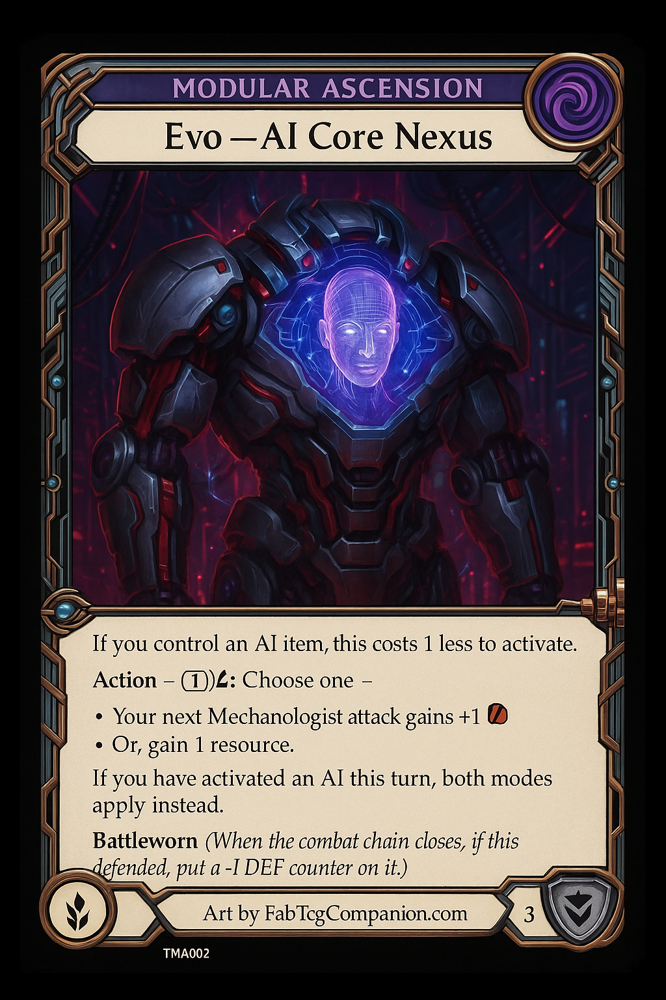
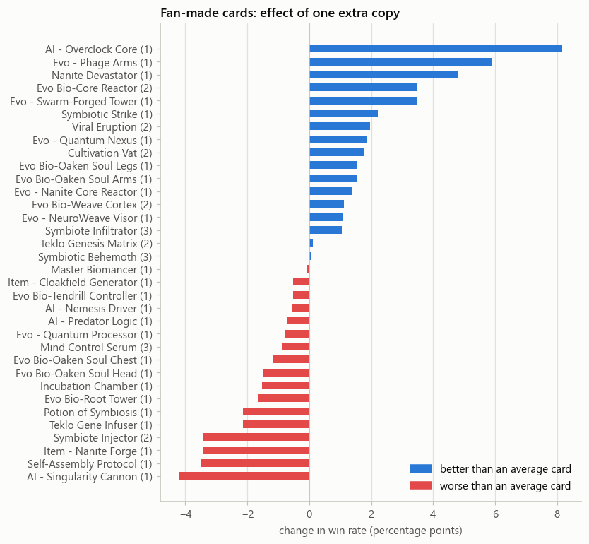

# 🃏 Cards

## The fan-made Teklovossen cards

Teklovossen is a Mechanologist hero from Flesh and Blood. The official card pool now makes him competitive on his own, so these are **dream cards**: fan-made designs along four tech paths, tried out in the simulator for fun and for learning, not to fix the hero. The full card texts and design notes are in [`teklostudy.md`](../teklostudy.md); the concept art is in [`evos/`](../evos).

| Path | Focus | Key cards | Mechanics |
|---|---|---|---|
| 🟣 **AI** | AI items and combat protocols | `AI - Overclock Core`, `AI - Predator Logic`, `AI - Singularity Cannon` | AI item synergies, attack boosts, resource conversion |
| 🟢 **Nano** | self-replicating nanites, adaptive armor | `Evo - Nanite Core Reactor`, `Evo - Phage Arms`, `Nanite Devastator` | Nanite counters, equipment transformation, adaptive defense |
| 🔵 **Quantum** | probability control | `Evo - Quantum Processor`, `Evo - Quantum Nexus` | Quantum charges, probability effects |
| 🌿 **Bio** (Biomancy) | bio-mechanical symbiosis | `Evo Bio-Oaken Soul` set, `Evo Bio-Core Reactor`, `Symbiotic Strike` | Symbiote tokens, biological enhancement, scaling |

  
  
  
  
   Concept art from <code>evos/</code>: Nano, AI, Quantum and Biomancy Evos (AI-generated).

## Where the cards come from

| Source | File | Used for |
|---|---|---|
| Official card database | [`notebooks/card.csv`](../notebooks/card.csv) (tab-separated) | Mechanologist and Generic cards for random decks; Generic cards for the reference opponent |
| Fan-made cards | [`custom_cards.csv`](../custom_cards.csv) (tab-separated, same columns) | the 38 Teklovossen designs |

[`teklo.load_cards`](../teklo/cards.py) keeps the cards a deck plays from hand: **attacks**, non-attack **actions**, **instants**, **items** and **Evo** equipment (including an Evo weapon). Heroes, plain equipment and weapons, reactions, allies and tokens are left out, and so are cards whose cost is `X`. Cards of other classes (Warrior, Wizard, ...) are left out too.

That gives 698 usable cards, 34 of them fan-made. The 4 fan-made cards left out are *Teklovossen, the Bio-Ascendant* (a demi-hero), *Proto Earth Base* (plain equipment), *Bio-Infusion Chamber* (a weapon without Evo) and *Earth Synaptic Creature* (an ally).

Card ids are `Name (pitch)`, for example `Zipper Hit (3)`, because most cards exist in red, yellow and blue.

## The rules-text parser

`teklo.parse_effects` turns rules text into a few numbers the simulator understands. It is deliberately small:

| Pattern in the text or keywords | Becomes |
|---|---|
| keyword `Go again` | `go_again` |
| keyword `Boost` | `boost` |
| `+N{p}`, `+N attack`, `+N power` (non-attack cards only) | `power_bonus` (max 3) |
| `draw a card`, `draw two cards` | `draw` (max 2) |
| `gain N{r}`, `gain N Teklo Energy` | `energy` (max 2) |
| `deal N damage`, `deal N arcane damage` | `damage` (max 3) |
| `gain N{h}` | `life` (max 3) |

Anything else is ignored. An attack's own `+N{p}` is usually conditional, so it does not count.

> **Important:** for most fan-made cards, `custom_cards.csv` stores only a type line (for example *Mechanologist Equipment - Chest - Evo Nano*), not the rules text. So the parser finds an effect on one fan-made card only, **AI - Overclock Core** (+2 power every turn). The others are judged on their stats: cost, pitch, power and defense. The real texts are in `teklostudy.md`; notebook 04 will hand them to an LLM.

## What the model says about each fan-made card

  

Notebook 03 estimates how much one extra copy of each card changes a deck's win rate. Read it with the parser limit above in mind: Overclock Core is on top because it is the only card whose text was understood, and cards at the bottom (Singularity Cannon, Nanite Forge) cost resources but, to the simulator, do nothing yet. This model is also noisy (R² 0.33), so only the ends of the chart are worth reading.

## Adding or changing a card

1. Add a row to `custom_cards.csv`, tab-separated, with at least `Name`, `Pitch`, `Cost`, `Power`, `Defense`, `Types` and `Card Keywords`.
   - `Types` decides the kind and theme: include `Mechanologist`, one of `AI`, `Nano`, `Quantum` or `Bio`, and `Attack`, `Action`, `Instant`, `Item` or `Equipment, Evo, <Head|Chest|Arms|Legs>`.
   - Put the rules text in `Functional Text`, using the patterns above if you want the simulator to understand it (for example `Your next attack gains +2{p}.`).
2. Check how it was read: `teklo.cards_frame(teklo.load_cards(...))` shows the `fx_` columns.
3. Re-run notebooks 01 to 03 to see how decks with it perform.

## Design guidelines (from v1)

These guidelines come from the original design work and still describe the intent of the cards:

- **Equipment cost:** 2 to 5 Teklo Energy for Evo pieces. **Item activation:** 1 to 3 Teklo Energy per use.
- **Targets:** balance score 7+/10, power level 6 to 8, theme fit 9+.
- **Common balance problems:** too cheap for the effect, unlimited scaling, no counterplay, power creep.
- **Usual fixes:** raise the cost, add "once per turn" or a cap, add timing restrictions, add decay or upkeep.

Cards flagged as needing balance in v1: `AI - Singularity Cannon` (uncapped scaling), `AI - Predator Logic` (free reaction too strong), `Evo - Nanite Core Reactor` (missing cost definition).
